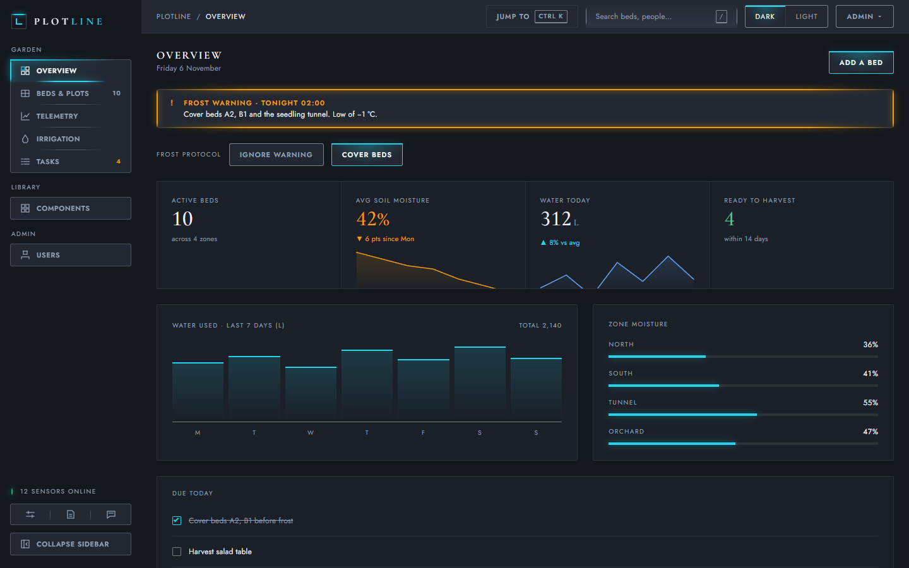
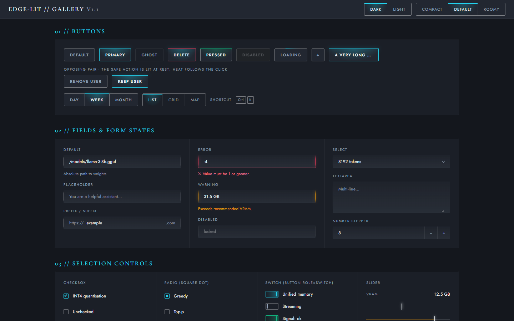
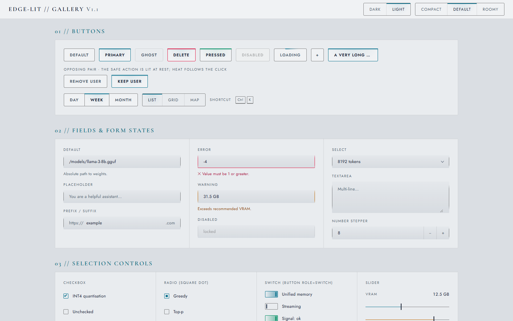
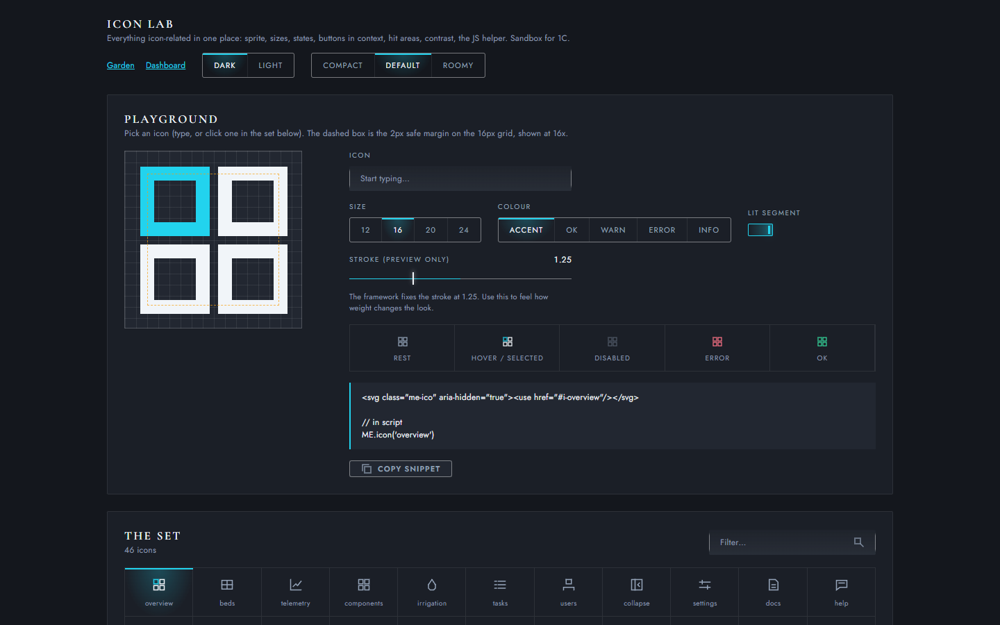
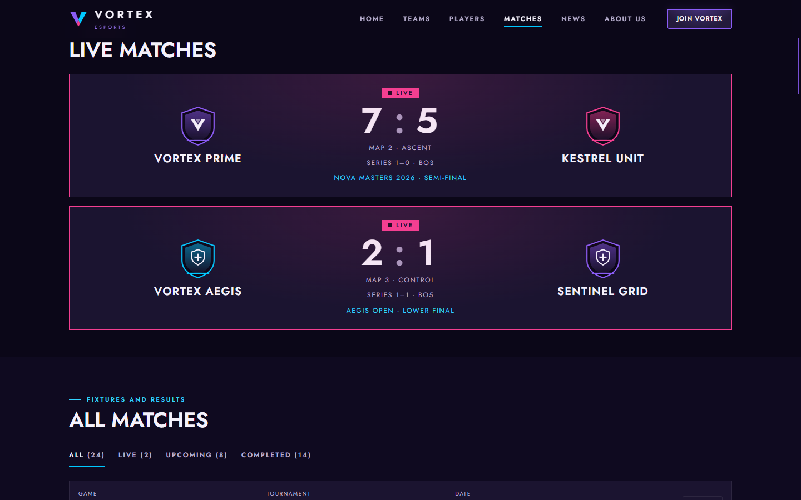
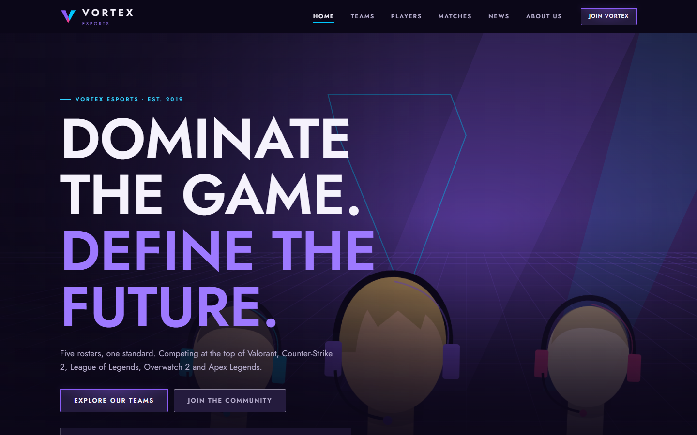

# EdgeLit

A UI framework where **light is structure**. Surfaces are flush and calm; state and boundaries are drawn as thin lines of light on the *edges* of things. No cards, no shadows, no rounded pills, no coloured icon packs. Dark and light themes, right-to-left support, and accessibility built in (WCAG 2.2 AA).

Plain CSS and JavaScript. No build step needed to use it, no dependencies, no framework required.



<table>
<tr>
<td width="50%"><br><sub><b>Component gallery</b>, dark theme (<code>gallery.html</code>)</sub></td>
<td width="50%"><br><sub><b>Same gallery</b>, light theme: same structure, different physics (etched instead of glowing)</sub></td>
</tr>
<tr>
<td width="50%"><br><sub><b>Icon lab</b> (<code>icons.html</code>): the 46-icon sprite, sizes, states and the JS helper</sub></td>
<td width="50%"><br><sub><b>VORTEX Esports match centre</b>: a multi-page example site built on EdgeLit with its own brand palette</sub></td>
</tr>
</table>



<sub>The VORTEX Esports example site (ten pages, a custom purple, blue and pink palette) was built as a stress test of the framework and is not included in this repository. It shows what a full re-brand needs: a block of colour variables and no changes to the components.</sub>

## Try it in 30 seconds

Clone the repo and open any of these straight from the folder (no server needed):

| Page | What it shows |
|---|---|
| `garden.html` | A full demo app. Sign in with `admin@plotline.io` / `garden` |
| `dashboard.html` | A dashboard |
| `gallery.html` | Every component and state, with theme and density switches |
| `icons.html` | The icon lab |
| `agent-kit/examples/starter.html` | A small page that already follows the rules. Copy it |

## Use it in your own page

```html
<!doctype html>
<html lang="en" data-theme="dark">          <!-- "dark" or "light" -->
<head>
  <meta charset="utf-8"><meta name="viewport" content="width=device-width,initial-scale=1">
  <link rel="stylesheet" href="edgelit.css">
</head>
<body class="me">                              <!-- required: the scope class -->
  <script src="edgelit-icons.js"></script>   <!-- first thing in body -->

  <button class="me-btn me-btn--primary">Hello</button>

  <script src="edgelit.js"></script>           <!-- optional: charts, pickers, palette ... -->
  <script src="edgelit-elements.js"></script>  <!-- optional: <me-*> elements -->
</body>
</html>
```

Keep `dist/` and `icons/` next to `edgelit.css`: it loads its tokens from there.

## What is in the repo

| Path | What it is |
|---|---|
| `edgelit.css` | The whole framework, in cascade layers |
| `edgelit.js`, `edgelit-elements.js` | Optional behaviour and `<me-*>` custom elements |
| `edgelit-icons.js`, `icons/` | The 46-icon sprite |
| `tokens/`, `dist/` | Design tokens (W3C format) and the generated CSS, JS and JSON |
| `fonts/` | Self-hosted Jost and Cormorant Garamond (SIL Open Font License, see `fonts/OFL-*.txt`) |
| `agent-kit/` | A self-contained folder with `DESIGN.md`, the framework and a starter. Point an AI agent at it |
| `docs-src/` | The README, user guide and how-it-works that ship in the release zip |
| `scripts/`, `tests/` | Build scripts and the Playwright test suite |

## Brand it

Give the helper one colour and it derives a contrast-safe accent for both themes, and warns when the colour is too close to a status colour:

```
node scripts/derive-accent.js "#7c3aed"            # preview
node scripts/derive-accent.js "#7c3aed" --write    # write into tokens/ and rebuild dist/
```

Or override the colour variables in your own stylesheet. See `docs-src/USER-GUIDE.md`, section 9.

## Develop

```
npm install
npm test                 # Playwright suite: layout, accessibility, RTL, tokens, release
npm run build            # icons, tokens, colour fallback, agent kit
npm run build:release    # release/EdgeLit-<version>.zip
```

Playwright on this project uses persistent browser profiles (see `fixtures.js`); import `{ test, expect }` from there rather than from `@playwright/test`.

## Browsers

Current Chrome, Edge, Firefox and Safari (roughly 2023 and later). It uses cascade layers, container queries, `:has()`, the Popover API and `color-mix()` (with an automatic fallback). Tested on Chromium, Firefox and WebKit.

## Licence

[MIT](LICENSE). The bundled fonts keep their own licence (SIL Open Font License 1.1); see [`docs-src/NOTICE.md`](docs-src/NOTICE.md).
